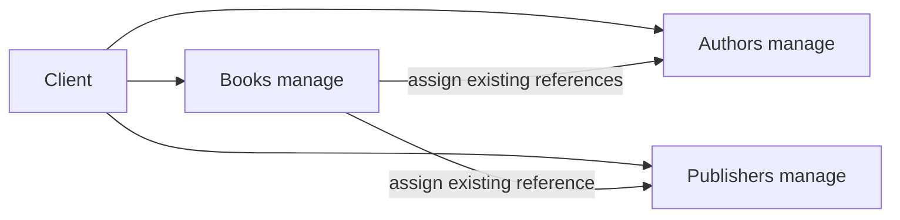

# Use Cases

Books can be created, searched, read, updated and deleted. Authors and publishers are
managed independently; a referenced author or publisher cannot be deleted while books
still refer to it.
